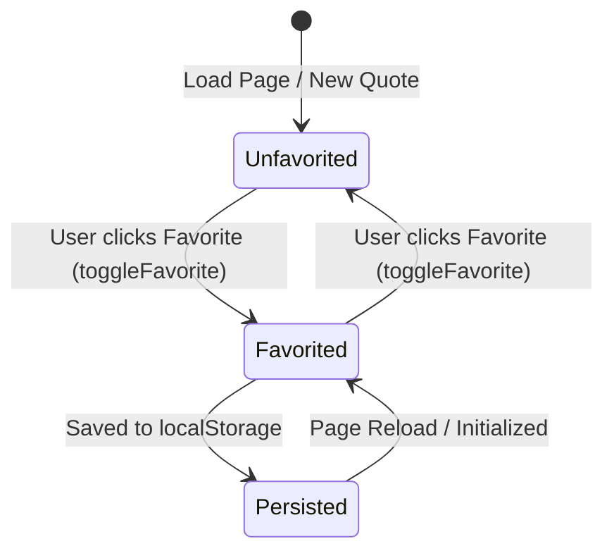

# Data Model: Quote of the Day

**Feature**: Quote of the Day (`001-quote-of-the-day`)  
**Date**: 2026-10-15  
**Status**: Completed  

---

## 1. Entities

### Quote
Represents a curated quotation item in the built-in catalog.

| Field | Type | Required | Description | Constraints |
|---|---|---|---|---|
| `id` | `string` | Yes | Unique identifier for the quote | Non-empty alphanumeric string (e.g. `"q1"`, `"q2"`) |
| `text` | `string` | Yes | The textual quote content | Non-empty string, trimmed |
| `author` | `string` | Yes | Source or creator of the quote | Non-empty string (e.g. `"Albert Einstein"`) |

#### Validation Rules
- `id` must be unique across the entire catalog.
- `text` must not be empty or whitespace-only.
- `author` must not be empty or whitespace-only.

---

### FavoriteCollection
Represents the user's saved favorite quotes, persisted locally.

| Field | In-Memory Type | Storage Type | Description |
|---|---|---|---|
| `favoriteIds` | `Set<string>` | `string` (JSON array of strings) | Set of quote `id`s marked as favorites |

#### Storage Format
- **Key**: `qotd_favorites_v1`
- **Serialized Value**: JSON array, e.g., `["q1", "q4", "q7"]`
- **Default State**: `[]` (empty array)

#### Validation & Sanitization Rules
- On retrieval, parsed JSON must be an array. Any element that is not a non-empty string is discarded.
- If JSON parsing fails (e.g., malformed syntax) or data is not an array:
  - System logs a warning in development mode.
  - Storage resets to an empty array `[]`.
  - Application continues operating without throwing uncaught errors.

---

## 2. State Machine & Transitions

### Favorite State Lifecycle

### Transition Matrix

| Current State | Action | Next State | Persistence Action | Visual Indicator |
|---|---|---|---|---|
| `Unfavorited` | `toggleFavorite(id)` | `Favorited` | Append `id` to stored array | Highlighted active icon, `aria-pressed="true"` |
| `Favorited` | `toggleFavorite(id)` | `Unfavorited` | Remove `id` from stored array | Inactive outline icon, `aria-pressed="false"` |
| Any | `getRandomQuote(currentId)` | Active quote updated | None (reads favorite status for new quote) | Reflects new quote's favorite state |
| Any | `Page Reload` | Loaded quote | Read favorites array from `localStorage` | Re-establishes favorite status |

