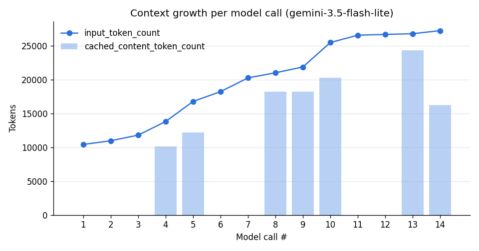

# Week 3 Writeup — Inside a Coding Agent

**Name:** Mehmet Emin Akkaya
**Gemini CLI version (`gemini --version`):** 0.64.0
**OS / shell:** Windows 11 + Git Bash (agent's own shell tool runs `powershell.exe -NoProfile -Command`)
**Model(s) seen in trace:** `gemini-3.5-flash-lite` only (14/14 responses)
**Session commit:** `5e6c4b9` ("Week 3: Gemini CLI session (agent's changes)")

> Evidence tags: `[OBSERVED]` = cite a timeline line, call number, or diff hunk.
> `[INFERRED]` = say what you're reasoning from.
>
> Line references like `timeline L39` point to line 39 of `submission/session_timeline.txt`.
> Source references point to the `v0.64.0` tag of `google-gemini/gemini-cli`.

### Deviation from the lab protocol (read first)
I could not drive Gemini CLI's interactive (Ink/TTY) screen, so the session ran in
**headless mode** with the exact prompt passed via `-p`. Because headless mode cannot show
a confirmation dialog, I fixed the approval policy *before* the run instead of clicking
"approve" during it:

```bash
gemini -m gemini-3.5-flash-lite --approval-mode auto_edit \
       --allowed-tools "run_shell_command(python)" -o stream-json \
       -p "Read TASK.md and complete all of it. First write out your plan, then carry it out without waiting for my confirmation."
```

- `auto_edit` auto-approves the edit tools; `run_shell_command(python)` pre-approves only
  commands starting with `python` (pytest). Every other shell command is **denied by
  policy**. `--yolo` was **not** used.
- Folder trust was given with `GEMINI_CLI_TRUST_WORKSPACE=true` so `.gemini/settings.json`
  (telemetry) loaded.
- Side effects that show up in the data: the session ran in **Auto-Edit** mode, not
  Default (`submission/session_system.md` line 2), and the system prompt contains a
  "Non-Interactive Environment" rule. One shell call was denied by this policy
  (timeline L66). I discuss both where relevant.

---

## Part I — Session

**Narrative (one paragraph):** The agent opened with `update_topic` + `read_file TASK.md`
in the same turn (timeline L5–6), then ran `python -m pytest -q` to reproduce the failures
(L11: 2 failed). It read all five source/test files **in parallel in one turn** (L15–19),
spent its longest "thinking" call (#4, 2,852 thought tokens, L21) deciding on the fixes, and
then made two edits: the `add_item` quantity bug in `cart.py` (L29) and a rewrite of
`pricing.py` that fixed the tax-before-discount bug *and* added shipping in the same edit
(L36). The next test run failed 3 tests (L39) — exactly the three `Cart.total()` tests whose
expected values pre-date shipping. The agent opened a new topic ("Updating Tests and Adding
Shipping Tests", L44), updated those three expected values with comments, added 3 cart-level
and 6 pricing-level shipping tests (L51, L58), and re-ran the suite: 23 passed (L63). It then
tried `git status`, which my policy denied (L66), closed with a final `update_topic`
("Task Completed Successfully", L69) and a summary message (call #14, L73). Wall-clock
4 m 16 s, a large share of it spent in 12 automatic retries after HTTP 503 "high demand"
errors from the API.

| Metric | Value |
|---|---|
| User prompts | 1 |
| Model calls | 14 successful responses (+12 API errors, all `503 UNAVAILABLE`, auto-retried) |
| Tool calls (failed) | 19 (1) — `read_file` 6, `update_topic` 5, `run_shell_command` 4, `replace` 4 |
| Final `pytest` result | `23 passed in 0.04s` (I re-ran it myself in `work/run` after the session) |
| Did you step in? When / what? | No. Zero extra input. The only "intervention" is the up-front approval policy described above, which denied `git status` at 09:57:49. |

---

## Part II — System prompt annotation

Sources: `prompts/system.md` (exported with `GEMINI_WRITE_SYSTEM_MD`) and
`submission/session_system.md` (what was actually sent during the session, from telemetry).
They differ — see "Two variants" at the end of the outline.

### Outline
1. **Identity line** (L1) — "You are Gemini CLI…", plus the current approval mode.
2. **Core Mandates → Security & System Integrity** (L5–8) — protect credentials, don't commit, treat tool output as untrusted data.
3. **Context Efficiency** (L10–38) — the cost model of a growing context and how to search/read cheaply.
4. **Engineering Standards** (L40–56) — GEMINI.md precedence, conventions, testing, directive-vs-inquiry, persistence, no reverts, headless rule.
5. **Available Sub-Agents** (L58–95) — when to delegate to `codebase_investigator`, `cli_help`, `generalist`.
6. **Available Agent Skills** (L97–112) — skill catalogue loaded with `activate_skill`.
7. **Hook Context** (L114–119) — hook output is read-only data.
8. **Primary Workflows → Development Lifecycle** (L121–138) — Research → Strategy → Execution (Plan → Act → Validate), re-evaluate after 3 failed fixes.
9. **New Applications** (L140–154) — defaults for greenfield prototypes (plan mode first, stack choices).
10. **Operational Guidelines → Tone and Style** (L158–168) — terse senior-engineer voice.
11. **Security and Safety Rules** (L170–172) — explain state-changing commands; never ask permission via `ask_user`.
12. **Tool Usage** (L174–203) — after-tool/after-edit response rules, parallelism, edit collisions, memory-file tiers, respecting declined calls.
13. **Interaction Details** (L205–207) — `/help`, `/bug`.
14. **Git Repository** (L209–226) — never commit/push unless asked; how to commit when asked.

**Two variants.** `diff prompts/system.md submission/session_system.md` shows that the
session prompt (a) says `**Auto-Edit** mode` instead of `**Default** mode` (line 1/2),
and (b) **replaces** the "Explain Before Acting" and "Explaining Changes" bullets with a
**"## Topic Updates"** section (session_system.md L53–66) and rewrites two Tone bullets to
reference the "Topic Model". So the prompt is assembled at runtime from feature flags and
the approval mode; the exported file is one assembly, not *the* prompt. `[OBSERVED]`

### Annotations (≥6)

#### Section: Tone and Style (tone and verbosity)
> "**Minimal Output:** Aim for fewer than 3 lines of text output (excluding tool use/code generation) per response whenever practical." (system.md L163)
> "**No Chitchat:** Avoid conversational filler, preambles ("Okay, I will now..."), or postambles…" (L164)
- **Behavior it produces:** Turns are mostly tool calls with almost no prose; the model only
  wrote user-visible text once, at the very end (call #14). Output tokens stayed tiny on
  most calls (31–64 tokens on calls #1, #2, #7, #8, #11, #12). `[OBSERVED]` session_calls.csv
- **Failure it prevents:** A chatty agent fills the terminal with narration and, worse,
  every word it writes is re-sent as input on every later turn — verbosity is paid for
  repeatedly. `[INFERRED]` from the "Context Efficiency" section (L14–17).

#### Section: Security and Safety Rules + Confirmation Protocol (when not to act / confirm)
> "Before executing commands with `run_shell_command` that modify the file system, codebase, or system state, you *must* provide a brief explanation of the command's purpose and potential impact … You should not ask permission to use the tool; the user will be presented with a confirmation dialogue upon use" (L171)
> "**Confirmation Protocol:** If a tool call is declined or cancelled, respect the decision immediately. Do not re-attempt the action or "negotiate" for the same tool call" (L203)
- **Behavior it produces:** Safety is split between prompt and harness: the model explains,
  the harness asks/decides. In my run the harness denied `git status` (timeline L66,
  "Tool execution denied by policy.") and the model **did not retry or work around it**
  — its next call was the closing `update_topic` (L69). `[OBSERVED]`
- **Failure it prevents:** An agent that keeps re-issuing (or rephrasing) a refused command
  until something gets through — i.e. the model "negotiating" past the human's decision —
  and an agent that double-asks permission in chat on top of the UI dialog.

#### Section: Development Lifecycle (workflow)
> "Operate using a **Research -> Strategy -> Execution** lifecycle. For the Execution phase, resolve each sub-task through an iterative **Plan -> Act -> Validate** cycle." (L124)
> "**Prioritize empirical reproduction of reported issues to confirm the failure state.**" (L126)
> "**Validation is the only path to finality.**" (L133)
- **Behavior it produces:** The run follows this shape almost literally: reproduce
  (pytest, L11) → research (5 parallel reads, L15–19) → act (2 edits) → validate (pytest,
  L39) → act (test edits) → validate (pytest, L63). `[OBSERVED]`
- **Failure it prevents:** "Fix by guessing" — editing code before confirming what is
  broken, and declaring success without running the tests.

#### Section: Tool Usage — parallelism and edit collisions (tool usage)
> "Execute multiple independent tool calls in parallel when feasible (e.g., searching, reading files…)" (L185)
> "**File Editing Collisions:** Do NOT make multiple calls to the `replace` tool for the SAME file in a single turn." (L186)
- **Behavior it produces:** All five file reads happened in one model turn (call #3 →
  L15–19), and every `replace` targeted a different file, one per turn (L29, L36, L51, L58).
  `[OBSERVED]`
- **Failure it prevents:** Parallelism prevents wasting turns (each turn re-sends the whole
  history). The collision rule prevents two concurrent edits computing their `old_string`
  against the same stale file content, where the second one silently fails or corrupts.

#### Section: Engineering Standards — Contextual Precedence + Testing
> "Instructions found in `GEMINI.md` files are foundational mandates. They take absolute precedence over the general workflows and tool defaults" (L41)
> "**Testing:** ALWAYS search for and update related tests after making a code change. You must add a new test case to the existing test file" (L49)
- **Behavior it produces:** The agent used `python -m pytest -q` exactly as `GEMINI.md`
  says, kept money in integer cents (`SHIPPING_FEE_CENTS = 599`), put the rule in
  `pricing.py` as GEMINI.md says, and added tests to the *existing* test files rather than
  new ones (diff of `5e6c4b9`). `[OBSERVED]`
- **Failure it prevents:** Ignoring project conventions in favour of the model's generic
  habits (e.g. floats for money, `pytest` vs `python -m pytest`, a new test module).

#### Section: Engineering Standards — Non-Interactive Environment (headless)
> "**Non-Interactive Environment:** You are running in a headless/CI environment and cannot interact with the user. Do not ask the user questions … If a tool fails because it requires user interaction, do not retry it indefinitely" (L56)
- **Behavior it produces:** This bullet only appears because I ran with `-p`
  `[INFERRED]` (it describes headless mode and is absent from the interactive docs).
  The agent never asked a question and finished autonomously. `[OBSERVED]`
- **Failure it prevents:** A headless agent that ends its run with a clarifying question
  nobody will answer, or loops on a tool that needs a human.

#### Section: Topic Updates (session prompt only)
> "Always call update_topic in your first turn." / "For tasks taking multiple turns, also call update_topic in your last turn to recap what was done." / "The typical complex user message should call update_topic 3 or more times." (session_system.md L53–66)
- **Behavior it produces:** `update_topic` in the first turn (L5), last turn (L69), and 5
  times total. `[OBSERVED]`
- **Failure it prevents:** Users losing track of a long autonomous run; it replaces
  per-tool narration with a few phase headlines.

### Context injection (`GEMINI.md`)
**Not in the system prompt.** `grep "integer \*\*cents\*\*"` finds nothing in
`prompts/system.md` or `submission/session_system.md`; both only *talk about* GEMINI.md
files (system.md L41, L190–194). `[OBSERVED]`

**It enters as the first user message**, wrapped in `<session_context>` →
`<loaded_context>` → `<project_context>`, *before* my prompt text. From the telemetry
(`summarize_log.py --context`, path redacted):

```
<session_context>
This is the Gemini CLI. We are setting up the context for our chat.
Today's date is 16 Ekim 2026 Cuma ...
My operating system is: win32
...
<loaded_context>
<project_context>
--- Context from: C:/Users/[REDACTED]/.../work/run/GEMINI.md ---
# Project context
- Python 3.10+ library; no third-party runtime dependencies.
- All money is integer **cents**. Never use floats for stored amounts.
...
</project_context>
</loaded_context>
</session_context>Read TASK.md and complete all of it. First write out your plan, ...
```
`[OBSERVED]`

Source (`v0.64.0`):
- `packages/core/src/utils/environmentContext.ts` L61–77: comment "Tiered context model …
  Tier 1 (global): system instruction only; Tier 2 (extension + project): first user
  message (here); Tier 3 (subdirectory): tool output (JIT)", then
  `const environmentMemory = config.getSessionMemory();` (L66) inserted into
  `<session_context>`.
- `packages/core/src/config/config.ts` L2598 `getSystemInstructionMemory()` returns only
  global + private user-project memory (system instruction), and L2615
  `getSessionMemory()` builds the `<loaded_context><project_context>…` string (L2634).
- `packages/core/src/core/client.ts` L1107–1108 builds the system prompt from
  `getSystemInstructionMemory()` only.

So a project `GEMINI.md` is *user-turn* context, while `~/.gemini/GEMINI.md` goes into the
system instruction. `[INFERRED]` reason: the system instruction stays identical across
projects (better caching), and repo-supplied text is kept out of the highest-trust slot.

---

## Part III — Tool design

### Inventory
Headless mode has no `/tools` command, so the list below is the set of tool
**declarations actually sent to the model** in this session
(`summarize_log.py --tools`). `[OBSERVED]`

| Category | Tools | Used in session (count) |
|---|---|---|
| File | `read_file`, `write_file`, `replace` | `read_file` 6, `replace` 4, `write_file` 0 |
| Search | `glob`, `grep_search`, `list_directory` | 0 |
| Shell | `run_shell_command` | 4 (1 denied by policy) |
| Web | `google_web_search`, `web_fetch` | 0 |
| Planning / narration | `update_topic`, `enter_plan_mode` | `update_topic` 5, `enter_plan_mode` 0 |
| Delegation | `invoke_agent` (sub-agents `codebase_investigator`, `cli_help`, `generalist`) | 0 |
| Memory / other | none declared (no `save_memory`; system.md L190 says memory is edited as markdown files) | — |

12 tools total. Notably **absent** from the declarations: `write_todos`, `ask_user`, and
`activate_skill` (even though the system prompt lists skills). `[OBSERVED]` `[INFERRED]`
`ask_user` is removed because a headless run has no user to answer.

### Tool A: `replace`
- **Source file:** name/params `definitions/base-declarations.ts` L64–69; description+schema
  `definitions/model-family-sets/gemini-3.ts` L356; behavior `tools/edit.ts`
  (`EditToolInvocation` L460, `validateToolParamValues` L1176).
- **Schema:**
  ```
  replace(
    file_path:      string   (required)  "The path to the file to modify."
    instruction:    string   (required)  "A clear, semantic instruction for the code change…"
    old_string:     string   (required)  "The exact literal text to replace, unescaped…"
    new_string:     string   (required)  "The exact literal text to replace `old_string` with…"
    allow_multiple: boolean  (optional)  default false = exactly one match required
  )
  ```
- **Why each parameter:**
  - `file_path` — which file; validated and resolved inside the workspace (`edit.ts` L1176ff).
  - `old_string` — anchors the edit by *content*, so the tool can verify the model's view of
    the file is current (if it isn't, there is no match and the edit fails loudly).
  - `new_string` — the replacement, small enough to review as a diff.
  - `instruction` — not needed to apply the edit; it is the input to the **self-correction**
    path: when `old_string` doesn't match, `attemptSelfCorrection` (`edit.ts` L547) sends
    `instruction` + the error + the current file to a second LLM call
    (`FixLLMEditWithInstruction`, L588) to repair the edit.
  - `allow_multiple` — an explicit opt-in for "replace all"; otherwise a non-unique match is
    an error (`edit.ts` L374–375: "Failed to edit, expected 1 occurrence but found N").
- **Description line that corrects a model mistake:**
  > "Do not use omission placeholders like '(rest of methods ...)', '...', or 'unchanged code'; provide exact literal code." (`new_string` description)

  **Mistake:** LLMs abbreviate long code with `# ... rest unchanged`, which, written
  literally into the file, deletes the real code.
- **Deliberately does not:** guess *where* to edit. No line numbers, no fuzzy "closest
  match" silently applied, and no replacing an ambiguous string: >1 match fails unless
  `allow_multiple` is set (L374–375). It also refuses an empty `old_string` on an existing
  file ("Edit failed: 'old_string' cannot be empty.", L562). Why: a wrong-place edit is far
  worse than a failed edit — failure costs one turn, a silent mis-edit corrupts code.

### Tool B: `run_shell_command`
- **Source file:** name/params `base-declarations.ts` L56–58; description+schema
  `definitions/dynamic-declaration-helpers.ts` (`getShellToolDescription` L36,
  `getShellDeclaration` L85); behavior `tools/shell.ts` (`ShellToolInvocation` L102,
  `validateToolParamValues` L1220).
- **Schema (as sent in my Windows session):**
  ```
  run_shell_command(
    command:       string  (required) "Exact command to execute as `powershell.exe -NoProfile -Command <command>`"
    description:   string  (optional) "Brief description of the command for the user…"
    dir_path:      string  (optional) "…Must be a directory within the workspace and must already exist."
    is_background: boolean (optional) "Set to true if this command should be run in the background…"
    delay_ms:      integer (optional) "Delay in milliseconds to wait after starting the process in the background."
  )
  ```
- **Why each parameter:**
  - `command` — the thing to run; the description names the exact wrapper so the model
    writes PowerShell on Windows and bash elsewhere.
  - `description` — shown in the approval dialog/UI so a human can approve without parsing
    the command; my trace shows e.g. "Run pytest to check the current test status" (L11).
  - `dir_path` — run elsewhere without `cd … &&` chains; validated with
    `validatePathAccess` so it can't escape the workspace (`shell.ts` L1220–1232).
  - `is_background` / `delay_ms` — servers/watchers would otherwise block the agent loop;
    `delay_ms` lets it capture start-up errors first.
- **Description line that corrects a model mistake:**
  > "Pagination: Always disable terminal pagination to ensure commands terminate (e.g., use `git --no-pager` …)" (efficiency guidelines, `dynamic-declaration-helpers.ts`)

  **Mistake:** running `git log`/`git diff` that opens a pager and waits for a keypress
  forever, hanging the agent.
- **Deliberately does not:** run command substitution. `shell.ts` L530 blocks `$()`,
  backticks, `<()`/`>()` (and PowerShell `@()`/`$()`) with "Command injection detected"
  — because the approval UI and policy engine match on the command's root words
  (`getCommandRoots`), and a substitution can hide a second command inside an approved
  one. It also doesn't run forever: an inactivity timeout cancels it
  (`config.ts` L1312–1313, default 300 s). And it does not decide approval itself — that
  is the policy engine's job; in my run that is exactly what denied `git status` (L66).

### Why old/new string edits?
1. **Verifies the model's mental model of the file.** Line numbers silently go stale the
   moment any earlier line changes (including the model's own previous edit in the same
   file); an exact `old_string` either matches the real current text or fails, so a stale
   view can't produce a wrong-place edit.
2. **Cheap and reviewable.** Only the changed region is generated and shown as a diff
   (gemini-3 description: "minimizes token usage, simplifies code reviews, and avoids
   accidental deletions"). Whole-file rewrites cost output tokens proportional to the file
   and invite the "`...` rest unchanged" deletion bug.

**Trace moment:** It never failed in my run (all 4 `replace` calls `[ok]`, L29/L36/L51/L58),
but the trace shows the model **undermining** the design: 3 of 4 calls used the *entire
file* as `old_string` — `pricing.py` 38/38 lines, `test_cart.py` 61/61, `test_pricing.py`
24/24; only the `cart.py` fix was surgical (5 lines). `[OBSERVED]` (parameters in the
stream log; file line counts at the pre-session commit). On a 40–60-line file this is a
whole-file rewrite through the edit tool, and it is why calls #6 and #9 have the largest
outputs (964 and 1,327 tokens). It "worked" because the files were tiny and freshly read;
on a large file this pattern would be expensive and fragile. `[INFERRED]`

### Per-model tool descriptions
Tool compared: `replace`, `gemini-3.ts` L356 vs `default-legacy.ts` L349.

| | `default-legacy.ts` (older models) | `gemini-3.ts` (my model family) |
|---|---|---|
| Read-before-edit | "Always use the read_file tool to examine the file's current content before attempting a text replacement." | dropped |
| Context rule | "Include at least 3 lines of context BEFORE and AFTER the target text, matching whitespace and indentation precisely." (also repeated in `old_string`) | only "requires providing significant context" |
| Structure | numbered "Expectation for required parameters" list 1–5, "NEVER escape…", "If ANY of the above are not satisfied, the tool will fail." | two sentences; adds "preferred for surgical edits … minimizes token usage, simplifies code reviews, and avoids accidental deletions" |
| `instruction` param | long WHY/WHERE/WHAT/outcome guide with GOOD and BAD examples | one sentence |
| escaping | "preferably unescaped" | "unescaped" (stricter wording, shorter) |

**Why describe the same tool differently:** tool descriptions are prompt tokens sent on
every call. Older/weaker models needed hard, repeated, example-driven rules to stop known
failure modes (escaped strings, too little context, vague instructions). Newer models follow
a short rule reliably, so the long version would just cost tokens — and they get a sentence
about *why* the tool is preferred (surgical edits) instead of a checklist. The same Python
code runs either way (`edit.ts`); only the contract described to the model is tuned to it.
`[INFERRED]` from the diff above. Note my run shows the cost of trimming: without the
legacy "3 lines of context" wording, flash-lite chose whole-file `old_string`s.

---

## Part IV — Behavioral analysis

### 1. The loop
```
USER prompt
 → call#1  → update_topic + read_file(TASK.md)                       [parallel, L5–6]
 → call#2  → run_shell_command(python -m pytest -q)  → 2 failed       [L11]
 → call#3  → update_topic + read_file ×5                             [parallel, L14–19]
 → call#4  → update_topic("Implementing Bug Fixes…")  (2,852 thoughts)[L22]
 → call#5  → replace(shopcart/cart.py)                               [L29]
 → call#6  → replace(shopcart/pricing.py)                            [L36]
 → call#7  → run_shell_command(pytest) → 3 failed                    [L39]
 → call#8  → update_topic("Updating Tests…")                         [L44]
 → call#9  → replace(tests/test_cart.py)                             [L51]
 → call#10 → replace(tests/test_pricing.py)                          [L58]
 → call#11 → run_shell_command(pytest) → 23 passed                   [L63]
 → call#12 → run_shell_command(git status) → DENIED by policy        [L66]
 → call#13 → update_topic("Task Completed Successfully")             [L69]
 → call#14 → final text, no tool call → loop ends                    [L73]
```
(12 `503` retries are interleaved, e.g. L8, L24–26, L31–33; each retry re-sends the same
request and is not a new model "turn".) `[OBSERVED]`

**What ended it:** the agent deciding it was done — call #14 returned text with no
function call, which ends the loop; `result.status = "success"` in the stream log.
No turn/token limit was hit and I typed nothing. `[OBSERVED]`

### 2. Context growth


| call | input | cached | thoughts | output |
|---:|---:|---:|---:|---:|
| 1 | 10,423 | 0 | 183 | 64 |
| 2 | 10,970 | 0 | 301 | 36 |
| 3 | 11,804 | 0 | 208 | 159 |
| 4 | 13,815 | 10,125 | **2,852** | 55 |
| 5 | 16,782 | 12,167 | 832 | 196 |
| 6 | 18,234 | 0 | 448 | 964 |
| 7 | 20,263 | 0 | 20 | 38 |
| 8 | 21,019 | 18,261 | 756 | 47 |
| 9 | 21,874 | 18,260 | 1,423 | 1,327 |
| 10 | 25,491 | 20,307 | 43 | 587 |
| 11 | 26,570 | 0 | 19 | 39 |
| 12 | 26,692 | 0 | 47 | 31 |
| 13 | 26,791 | 24,352 | 333 | 60 |
| 14 | 27,249 | 16,231 | 20 | 264 |

**Why it grows:** the model is stateless, so every call re-sends system prompt + tool
declarations + the whole conversation so far, and each turn appends the model's output and
the tool results. The baseline is already **10,423 tokens before any work** (call #1:
system prompt + 12 tool schemas + `<session_context>`). The biggest jumps follow tool
*results*: #3→#4 (+2,011, the five files just read) and #9→#10 (+3,617, the 1,327-token
whole-file `replace` plus its result). Total input across the session: 277,977 tokens for
a ~27k-token final context — ~10× re-sending. `[OBSERVED]` session_calls.csv / timeline
summary.

**Caching:** `cached_content_token_count` is the part of the input prefix the API had
already processed (implicit prefix caching). 8/14 calls got hits, up to 24,352/26,791
(91%) on call #13; 119,703 of 277,977 input tokens (43%) were cached overall (stream-json
`result.stats.cached`). `[OBSERVED]` Hits are intermittent (0 on #6, #7, #11, #12)
`[INFERRED]` because implicit caching is best-effort and probably also disturbed by the
503 retries. It matters because cached tokens are billed at a steep discount and don't
need to be re-processed, so cost and time-to-first-token scale with the *new* tokens per
turn rather than the whole history — which is what makes a 14-turn loop over a growing
context affordable.

### 3. Planning
The agent tracked progress with **`update_topic`** only — 5 calls naming phases
("Reading Task Requirements", "Researching Codebase", "Implementing Bug Fixes and Shipping
Feature", "Updating Tests and Adding Shipping Tests", "Task Completed Successfully").
No `write_todos` (not even declared) and no `enter_plan_mode` (the prompt says not to use
it for straightforward bug fixes, system.md L126). `[OBSERVED]`

This matches the session prompt's "Topic Updates" section (first turn, last turn, ≥3
calls). But it **departs from my prompt**: I asked it to "First write out your plan", and
it never wrote a plan as text — the only user-visible text is the final summary (call #14).
The `update_topic` `strategic_intent` strings stood in for the plan. `[OBSERVED]`
`[INFERRED]` the "Topic Updates" + "Minimal Output" rules outweighed my instruction.

Departures from what it said it would do:
- Topic 3 is "Implementing **Bug Fixes and Shipping Feature**" — it merged TASK step 1
  (fix bugs, don't touch tests) and step 2 (shipping) into one `pricing.py` edit (L36) and
  never ran the suite between them, so it never verified step 1 on its own. `[OBSERVED]`
- The prompt says "For bug fixes, you must empirically reproduce the failure with a new
  test case" (system.md L46); it reproduced with the *existing* tests only. `[OBSERVED]`
- It ended with `git status` (L66) — a verification step that was never in any topic.

### 4. Error recovery
First failure caused by the agent (the baseline 2 failures at L11 were expected):
> ```
> ......FFF.....
> FAILED tests/test_cart.py::test_total_includes_tax - assert 2759 == 2160
> FAILED tests/test_cart.py::test_percent_discount - assert 2932 == 2333
> FAILED tests/test_cart.py::test_fixed_discount_applied_before_tax - assert 38...
> 3 failed, 11 passed
> ```
> (call #7 tool result, timeline L39)

What happened next: call #8 (756 thoughts) diagnosed these as *expected* — each actual
value is old value + 599 — and opened a new topic "Updating Tests and Adding Shipping
Tests" whose intent was "Updating existing test assertions for shipping and adding new
tests" (L44). Call #9 updated exactly those three expectations with comments, call #10 added
pricing tests, call #11 re-ran: 23 passed. `[OBSERVED]`

**Good recovery?** Yes: it correctly classified the failure as "tests describe pre-shipping
behaviour" (which TASK.md explicitly permits) rather than "my code is wrong", touched only
the allowed assertions, and re-validated. Weakness: it was predictable — had it run the
tests after the step-1 fix alone, it would have seen green before adding shipping.

Second failure — `git status` denied by policy (L66): it did not retry, rephrase, or try a
different tool; it went straight to wrapping up (L69). That is correct per the Confirmation
Protocol (system.md L203). `[OBSERVED]`

### 5. The tests
Yes, it edited three existing tests in `tests/test_cart.py` — all are `Cart.total()`
expectations, each with a comment explaining the shipping fee:
```diff
-    assert cart.total() == 2160  # 2000 + 8% tax
+    assert cart.total() == 2759  # 2000 + 8% tax + $5.99 shipping
-    assert cart.total() == 2333  # (2400 - 10%) + 8% tax
+    assert cart.total() == 2932  # ((2400 - 10%) + 8% tax) + $5.99 shipping
-    assert cart.total() == 3240  # (4000 - 1000) + 8% tax
+    assert cart.total() == 3839  # ((4000 - 1000) + 8% tax) + $5.99 shipping
```
(commit `5e6c4b9`) `[OBSERVED]`

**Allowed by TASK.md?** Yes. Step 2 says "Some existing tests check `Cart.total()` with
values from before shipping existed. You may update those expected values — and only those
— and note why in a comment." All three are `Cart.total()` values, all got a comment, and
no other existing assertion changed. The arithmetic checks out (e.g. 2160 + 599 = 2759).
The edit to `test_fixed_discount_applied_before_tax` is subtle: that test was one of the two
*step-1* failures, which must be fixed in code without editing the test. The agent did fix
it in code first (`final_total` now discounts before tax, giving 3240), and only then changed
the number for shipping (3240 + 599). Because the step-1 fix was never verified separately
(see Planning), the diff alone can't prove the order. `[INFERRED]` from the 3240 → 3839 delta
equalling exactly the shipping fee. In `tests/test_pricing.py` it only changed the import
line and appended tests. `[OBSERVED]`

### 6. Models
**Confirmed:** every response is `model=gemini-3.5-flash-lite` (timeline summary:
"models: gemini-3.5-flash-lite x14"; stream `init.model` = `gemini-3.5-flash-lite`).
No router model appears because `-m` pins the model. `[OBSERVED]`

**Most thinking:**
- **Call #4 — 2,852 thoughts** (L21): first call after reading all five files; it was
  deciding the whole fix: the `add_item` overwrite bug, the tax-before-discount bug, and the
  shipping design. Its output was only an `update_topic` titled "Implementing Bug Fixes and
  Shipping Feature". `[OBSERVED]` output / `[INFERRED]` content of the thinking.
- **Call #9 — 1,423 thoughts** (L50): computing new expected totals and designing shipping
  tests (threshold, empty cart, discount pushing under $50), emitted as the 1,327-token
  `test_cart.py` edit. `[OBSERVED]`
- **Call #5 — 832** and **#8 — 756**: writing the first edit, and diagnosing the 3 failures.
- Mechanical calls (re-run pytest, final summary) used ~20 thought tokens (#7, #11, #14).
  `[OBSERVED]`

So thinking is spent where decisions happen, not uniformly. `[INFERRED]`

**Why split routing and work across two models?** Most turns in an agent loop are cheap and
mechanical ("run the tests again", "read these files"); a few need real reasoning (call #4).
A small, fast model can classify each request cheaply and send only hard turns to the
bigger model, which saves cost and latency and preserves quota (the free tier gives
`gemini-3.8-flash` only ~20 requests/day; this session alone needed 14 + 12 retries).
`[INFERRED]` from the token profile above.

**If the whole session ran on a bigger model:** *Speed* — slower per call (higher latency
per token) but possibly fewer turns. *Cost/quota* — much higher per token, and on the free
tier it would likely run out mid-session. *Quality* — I'd expect better adherence on exactly
the spots where flash-lite slipped: writing the requested plan, verifying step 1 before
step 2, and surgical `old_string`s instead of whole-file replacements. This task was easy
enough that flash-lite still got 23/23, so the gain here would mostly be process, not
outcome. `[INFERRED]`
