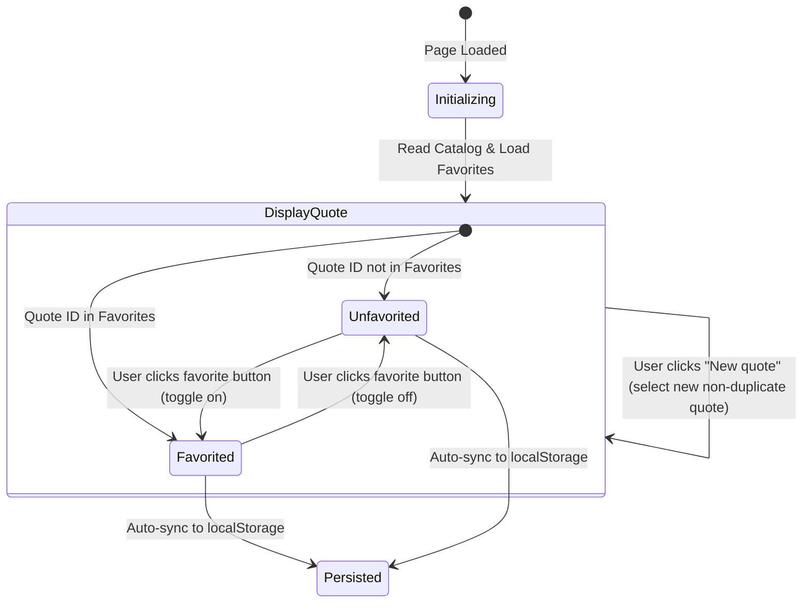

# Data Model: Quote of the Day

**Feature**: `001-quote-of-the-day`  
**Date**: 2026-10-20  
**Status**: Completed  

## 1. Entities

### 1.1 Quote Entity
Represents an individual quote in the built-in catalog.

```typescript
interface Quote {
  id: string;      // Unique immutable identifier (e.g., "quote-1", "quote-2")
  text: string;    // The body text of the quotation (non-empty string)
  author: string;  // The attributed person/source (non-empty string)
}
```

#### Validation Rules
- `id`: Must be a non-empty, unique string within the catalog.
- `text`: Must be non-empty and trimmed of extraneous leading/trailing whitespace.
- `author`: Must be non-empty; if unknown, defaults to `"Anonymous"`.
- Catalog size: The built-in list must contain at least 5 distinct quotes (satisfying FR-002).

---

### 1.2 Favorites Collection Entity
Represents the client-side state of favorited quotes.

```typescript
type FavoriteQuoteIds = string[]; // Array of unique Quote IDs serialized to localStorage
```

#### Validation & Constraints
- Only contains string IDs corresponding to valid `Quote.id` values (or ignored gracefully if an ID no longer exists).
- In-memory representation uses a `Set<string>` to ensure uniqueness and $O(1)$ lookup for favorited status checks.
- Serialized to `localStorage` under key `quote_of_the_day_favorites` as a JSON array (e.g., `["quote-1", "quote-3"]`).

---

### 1.3 Active View State
Represents the transient UI state of the application.

```typescript
interface ViewState {
  currentQuote: Quote;       // Currently displayed quote object
  isFavorite: boolean;       // Computed: favoritesSet.has(currentQuote.id)
  previousQuoteId: string | null; // ID of the quote shown previously (for non-repetition)
}
```

---

## 2. State Transitions



---

## 3. Storage Failure & Edge Case Handling

1. **Missing Storage Key**: If `localStorage.getItem("quote_of_the_day_favorites")` returns `null`, initialize an empty `Set` and do not throw.
2. **Corrupted JSON Payload**: If `JSON.parse` fails (e.g., invalid JSON syntax stored by a third script or manual edit), catch the syntax error, reset storage to `[]`, and return an empty `Set`.
3. **Storage Quota / Security Access Block**: If `localStorage` access is blocked (e.g., restricted browser privacy settings), catch the DOMException, log a warning to console, and operate in-memory for the current session.

